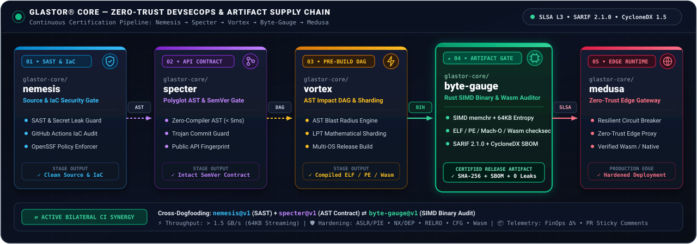

# 🛡️ GLASTOR® Byte-Gauge (`@glastor-core/byte-gauge`)

[](https://github.com/glastor-core/byte-gauge)
[](https://github.com/glastor-core)
[](https://github.com/glastor-core/byte-gauge)
[](https://github.com/glastor-core/byte-gauge)
[](https://github.com/glastor-core/byte-gauge)
[](./LICENSE)

**High-performance binary audit engine in Rust** (synchronous `std::fs` + **SIMD `memchr`** + **`checksec` / Binary Hardening** + structural analysis for **ELF / PE / Mach-O / WebAssembly (`.wasm`)** + **Global & 64 KB Window Shannon Entropy** + **Heuristic Masked Secret Hunter** + **SARIF 2.1.0** export + **CycloneDX 1.5 SBOM** + **PR Sticky Comments**).

Designed to complete the compiled artifact certification stage within the **[GLASTOR® Core](https://github.com/glastor-core)** ecosystem, operating in direct synergy with **[`glastor-core/specter`](https://github.com/glastor-core/specter)**, **[`glastor-core/vortex`](https://github.com/glastor-core/vortex)**, **[`glastor-core/medusa`](https://github.com/glastor-core/medusa)**, and **[`glastor-core/nemesis`](https://github.com/glastor-core/nemesis)**.

---

## 🔗 GLASTOR® Core Ecosystem Synergy (`Nemesis` ➔ `Specter` ➔ `Vortex` ➔ `Byte-Gauge` ➔ `Medusa`)

<p align="center">
  
</p>

| Stage | Repository | Role in the Supply Chain |
| :--- | :--- | :--- |
| **01 • SAST & IaC** | **[`glastor-core/nemesis`](https://github.com/glastor-core/nemesis)** | Static application security testing (SAST), secret leak prevention, and GitHub Actions IaC posture audit. |
| **02 • API Contract** | **[`glastor-core/specter`](https://github.com/glastor-core/specter)** | Zero-compiler polyglot AST differ (`< 5 ms`), public API surface cryptographic fingerprinting, and SemVer *Trojan Breaking Change* protection. |
| **03 • Pre-Build DAG** | **[`glastor-core/vortex`](https://github.com/glastor-core/vortex)** | AST impact blast-radius analysis, mathematical LPT test suite sharding, and multi-OS compilation pipeline. |
| **04 • Artifact Gate** | **`glastor-core/byte-gauge`** | **SIMD binary certification (`ELF`/`PE`/`Mach-O`/`Wasm`), `checksec`, localized 64 KB window Shannon entropy, SARIF 2.1.0, and CycloneDX 1.5 SBOM.** |
| **05 • Edge Runtime** | **[`glastor-core/medusa`](https://github.com/glastor-core/medusa)** | Resilient Zero-Trust edge API gateway with circuit-breaker capabilities to execute certified native binaries and Wasm modules. |

---

## 🚀 Enterprise Capabilities (`v0.1.0`)

1. **🌐 Native Multi-Format Inspection (`ELF` + `PE/PE32+` + `Mach-O` + `WebAssembly .wasm`)**:
   - Inspects native executables via `goblin` and **WebAssembly (`.wasm` v1)** modules using a zero-dependency native `uLEB128` section decoder (`Code (Bytecode)`, `Data (Static Memory)`, `Import`, `Export`, and unstripped `name` / `.debug*` section detection).
2. **🛡️ Binary Hardening (Native `checksec`)**:
   - Validates `ASLR / PIE`, `64-bit High-Entropy VA`, `NX / DEP`, `Full/Partial RELRO`, `Control Flow Guard (CFG)`, and `Wasm Linear Memory Sandbox`.
3. **🎯 Localized Entropy (`64 KB` Windows) + 🕵️ Heuristic Masked Secret Hunter (`--scan-entropy-secrets`)**:
   - Calculates global Shannon entropy alongside localized **64 KB peak window entropy (`peak_chunk_entropy`)** with exact hexadecimal offset reporting (`0x...`).
   - Detects high-entropy tokens (`32..=64` bytes, $H \ge 4.70\text{ bits/B}$) and **masks them (`aB3d...cE6g`)** to ensure secrets are never leaked into public CI execution logs.
4. **📦 Native CycloneDX 1.5 SBOM Generator (`--output-sbom`) + 🔒 SARIF 2.1.0 (`--output-sarif`)**:
   - Exports **Software Bill of Materials (CycloneDX v1.5 JSON)** containing the binary SHA-256 digest and dynamic shared library dependency graph (`DT_NEEDED` / DLLs).
   - Generates **SARIF 2.1.0** reports (`BG001` through `BG007`) integrated into **GitHub Security Code Scanning**.
5. **⚡ Multi-Binary Batch Mode + 💬 PR Sticky Comments + 📉 FinOps Regression Gate (`--max-regression-pct`)**:
   - Supports comma-separated binary paths (`--file-path "dist/app-linux,dist/app-win.exe,dist/edge.wasm"`), generating a consolidated **Multi-Binary Comparison Matrix**.
   - Automatically posts and updates an interactive **Sticky Comment on Pull Requests** (`post-pr-comment: "true"`).

---

## ⚙️ GitHub Action Usage (`glastor-core/byte-gauge@v1`)

```yaml
- name: Audit Release Binaries & Wasm Modules
  id: gauge
  uses: glastor-core/byte-gauge@v1
  with:
    file-path: "dist/vortex-linux-x64,dist/medusa-edge.wasm"
    scan-entropy-secrets: "true"
    max-size-mb: "120.0"
    max-regression-pct: "5.0"
    fail-on-debug: "true"
    baseline-json: ".byte-gauge/baseline.json"
    output-json: ".byte-gauge/current-audit.json"
    output-sarif: ".byte-gauge/byte-gauge.sarif"
    output-sbom: ".byte-gauge/byte-gauge.cdx.json"
    post-pr-comment: "true"
```

---

## 📄 License & Corporate Governance

Distributed under the **MIT** license.  

© 2010–2026 [GLASTOR®](https://glastor.es/) (INPI Reg. 4559568 & 4559567) • Dual-Hub Operations (Spain & Argentina · Factura E) • Led by [@glastor-dev](https://github.com/glastor-dev) (GitHub Developer Program Member).
